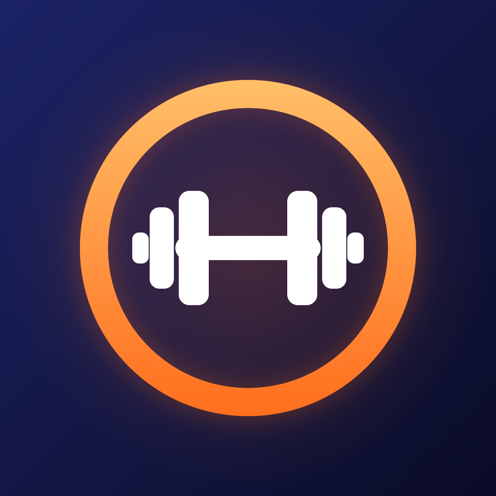
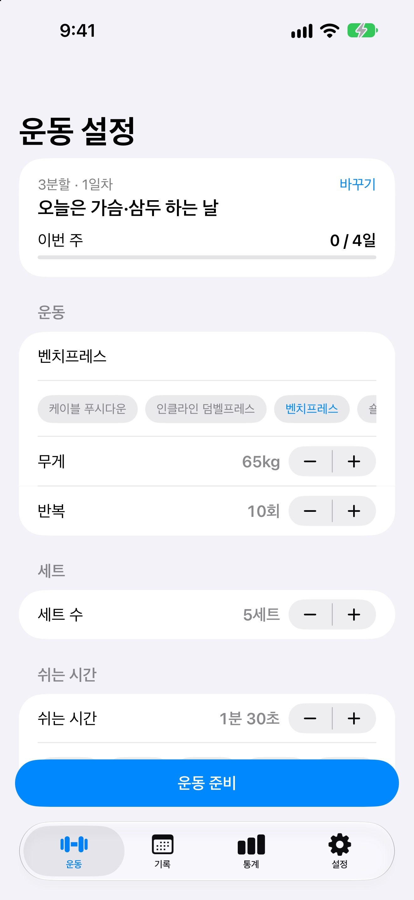
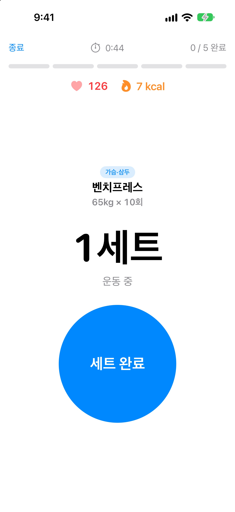
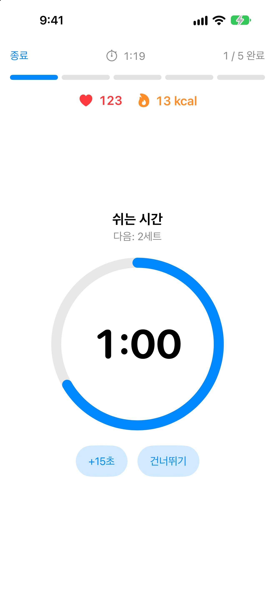
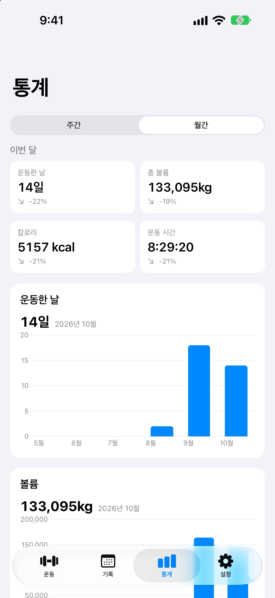
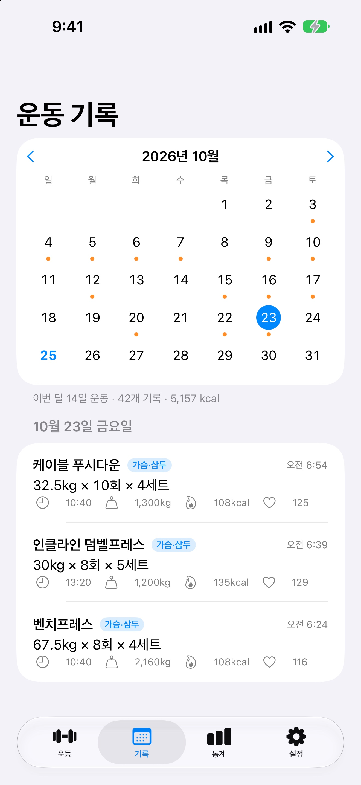

<p align="center">
  
</p>

<h1 align="center">세트 카운터 · Set Counter</h1>

<p align="center">
  세트를 마칠 때 한 번 누르면 카운트가 오르고 휴식 타이머가 시작되는 iPhone 운동 앱<br>
  SwiftUI · SwiftData · HealthKit · Core Bluetooth · AlarmKit · WidgetKit
</p>

<p align="center">
  
  
  
  
  
</p>

## 주요 기능

- **세트 카운트와 휴식 타이머**: 시작 → 세트 완료 한 번으로 카운트와 타이머가 동시에 진행
- **음악을 끊지 않는 알람**: 휴식이 끝나 알람이 울리는 동안만 음악을 멈추고, 끝나면 다시 재생
- **잠금 화면 알람**: 화면이 잠겨 있으면 시스템 알람(AlarmKit)으로 대신 울림
- **분할 루틴**: 1~6분할, 운동을 마칠 때마다 다음 부위로 자동 순환, 운동하는 날 아침 알림
- **기록과 통계**: 월간 캘린더, 주간·월간 운동일/볼륨, 부위별 세트, 운동별 무게 변화와 추정 1RM
- **심박수와 칼로리**: Apple Watch · AirPods Pro 3 · 블루투스 심박 스트랩 연결, 심박 기반 칼로리 추정
- **오늘의 코치**: 휴식일, 칼로리 초과, 유산소 진도, 부위 불균형, 체중 추세를 보고 하루 3줄 안내. 지난 기록으로 다음 무게·횟수를 잡아주는 추천 루틴
- **다이어트**: 기초대사량 기반 하루 권장 섭취, 목표 − 음식 + 운동 = 남은 칼로리, 식사 빠른 추가, 체중 추세와 목표선, 활동 링(활동 칼로리·운동 시간·걸음)
- **다른 러닝 앱 연동**: 나이키 런 클럽 · 피트니스 · 스트라바가 건강 앱에 저장한 러닝·걷기·사이클을 주간 유산소 목표와 캘린더에 합산, 앱 바로 열기
- **주간 리포트**: 근력·유산소·식단·체중을 지난주와 비교, 한 주의 마지막 날 저녁 알림
- **위젯**: 홈 화면(소·중), 잠금 화면(직사각형·원형)
- **그 밖에**: 한국어/English, 라이트·다크 테마와 강조 색, kg/lb, CSV 내보내기

## 구현하면서 해결한 문제

| 문제 | 해결 |
|---|---|
| 알람이 울릴 때만 다른 앱의 음악을 멈추고 다시 재생 | 알람 동안만 혼합 불가 `AVAudioSession`을 켜고, 끝나면 `.notifyOthersOnDeactivation`으로 비활성화 ([AlarmPlayer.swift](SetCounter/AlarmPlayer.swift)) |
| 앱이 백그라운드에서 멈추면 타이머가 울리지 않음 | 백그라운드로 갈 때 남은 시간으로 AlarmKit 알람을 예약하고 돌아오면 취소. 늦게 깨어난 타이머는 소리를 생략 ([WorkoutSession.swift](SetCounter/WorkoutSession.swift), [LockScreenAlarm.swift](SetCounter/LockScreenAlarm.swift)) |
| 알람 소리 파일 없이 여러 알림음 제공 | PCM 파형을 코드로 생성해 WAV로 재생 (삐삐삐 / 벨 / 부드러운 알림) |
| 블루투스 심박 센서 연결 | 표준 Heart Rate Service(0x180D) 측정값을 파싱하고, 저장된 센서는 자동 재연결 ([BluetoothHeartRate.swift](SetCounter/BluetoothHeartRate.swift)) |
| iPhone만으로 AirPods 심박수 받기 | iOS 26의 iPhone용 `HKWorkoutSession` + `HKLiveWorkoutBuilder`, Apple Watch 값은 `HKAnchoredObjectQuery`로 수신 ([HealthWorkout.swift](SetCounter/HealthWorkout.swift)) |
| 칼로리 추정 | 심박수가 있으면 Keytel(2005) 공식, 없으면 근력 운동 3.5 METs로 초 단위 적분 ([HeartRateMonitor.swift](SetCounter/HeartRateMonitor.swift)) |
| 앱을 안 열어도 자정·새 주에 위젯이 맞게 보이기 | App Group에 스냅샷을 저장하고, 위젯이 날짜를 보고 루틴 순환과 주간 진행을 스스로 넘김 ([WidgetSnapshot.swift](Shared/WidgetSnapshot.swift)) |
| App Group 추가 후 기존 기록이 사라짐 | SwiftData 기본 저장 위치가 그룹 컨테이너로 바뀌는 문제를 `groupContainer: .none`으로 고정 ([SetCounterApp.swift](SetCounter/SetCounterApp.swift)) |
| "1세트"와 "5세트"의 영어 번역이 다름 ("Set 1" / "5 sets") | String Catalog에 별도 키와 복수형(plural) 변형 사용 |
| 다른 앱의 러닝을 가져오되 내 근력 운동은 중복 없이 | HealthKit 운동 중 이 앱이 저장한 근력 운동만 제외하고, 걸음·활동·섭취는 `HKStatisticsCollectionQueryDescriptor`로 일별 합계 ([HealthData.swift](SetCounter/HealthData.swift)) |
| 한국은 주가 일요일에 시작해 "일요일 리포트"가 하루짜리 주가 됨 | 지역 설정의 주 시작 요일로 한 주의 마지막 날을 계산해 알림 예약 ([RoutineNotifications.swift](SetCounter/RoutineNotifications.swift)) |

## 구조

```
SetCounter/          앱 (SwiftUI 화면, 세션·알람·심박·HealthKit 로직)
SetCounterWidget/    위젯 확장
Shared/              앱과 위젯이 함께 쓰는 코드, 다국어 String Catalog
Config/              Info.plist, entitlements
AppStore/            스크린샷, 아이콘 생성 스크립트, 개인정보 처리방침, 배포 체크리스트
```

- 상태 관리: `@Observable` 세션 객체가 준비 → 운동 → 휴식 → 알람 → 완료 단계를 관리
- 저장: SwiftData(운동 기록), UserDefaults/`@AppStorage`(설정), App Group(위젯 스냅샷)
- 외부 서버·SDK 없음. 모든 데이터는 기기 안에만 저장 ([개인정보 처리방침](AppStore/PRIVACY_POLICY.md))
- 다음 단계: 대화형 AI 코치 설계 ([docs/AI_COACH_DESIGN.md](docs/AI_COACH_DESIGN.md))

## 빌드

- Xcode 27 이상, iOS 26.1 이상 (AlarmKit, iPhone용 HKWorkoutSession)
- `SetCounter.xcodeproj`를 열고 Signing & Capabilities에서 Team을 내 계정으로 바꾼 뒤 실행
- 번들 ID와 App Group(`group.com.andykim.SetCounter`)이 겹치면 내 것으로 바꿔주세요
- 심박수 센서가 없는 시뮬레이터에서는 Debug 빌드 실행 인자 `-demoHeartRate 126`으로 가짜 심박수를 넣을 수 있어요

## 앱 아이콘

[AppStore/make_icon.swift](AppStore/make_icon.swift)로 라이트·다크·틴트 아이콘을 생성합니다.

```bash
swift AppStore/make_icon.swift SetCounter/Assets.xcassets/AppIcon.appiconset
```
